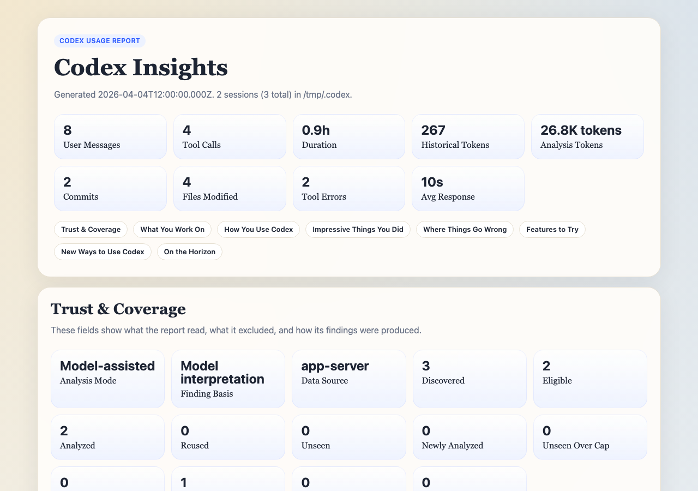

# Worked examples — November 2026

## Try a synthetic report without personal data

From a reviewed source checkout with the Node version required by `package.json`:

```sh
npm ci
npm run generate:test-report
```

Open `test-artifacts/sample-report/report.html` in a browser. The command uses `test/fixtures/sample-report.js`, writes synthetic JSON/HTML and makes no model calls. It does not read your Codex history. The fixture includes prewritten model-assisted labels and narrative to exercise rendering; those are not newly generated analysis.



The image is an actual browser capture of the generated fixture, not a live account report. To reproduce the image, open the generated HTML at a 1280 × 900 viewport and capture the initial viewport. Both the fixture and screenshot use the repository's MIT license.

## Analyze your local history privately

Using the published CLI:

```sh
npx @mangeshraut712/codex-insights@0.7.0 --local-only --days 7 --no-open
```

Inspect Trust & Coverage and the output paths printed by the CLI. This reads local session data; it is separate from the synthetic example. The published version does not yet include the source candidate's pagination fixes.

From the reviewed source candidate, request an uncapped main-thread collection:

```sh
node bin/codex-insights.js --local-only --data-source app-server --days 0 --limit 0 --include-archived --reanalyze --no-open
```

Short sessions are still excluded, transcript excerpts are bounded, and discovery depends on the server's inventory. See [known collection limits](app-server-compatibility.md). Review reports before sharing; local-only means no model calls, not automatic removal of all sensitive context.
